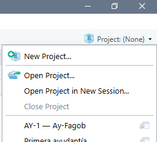
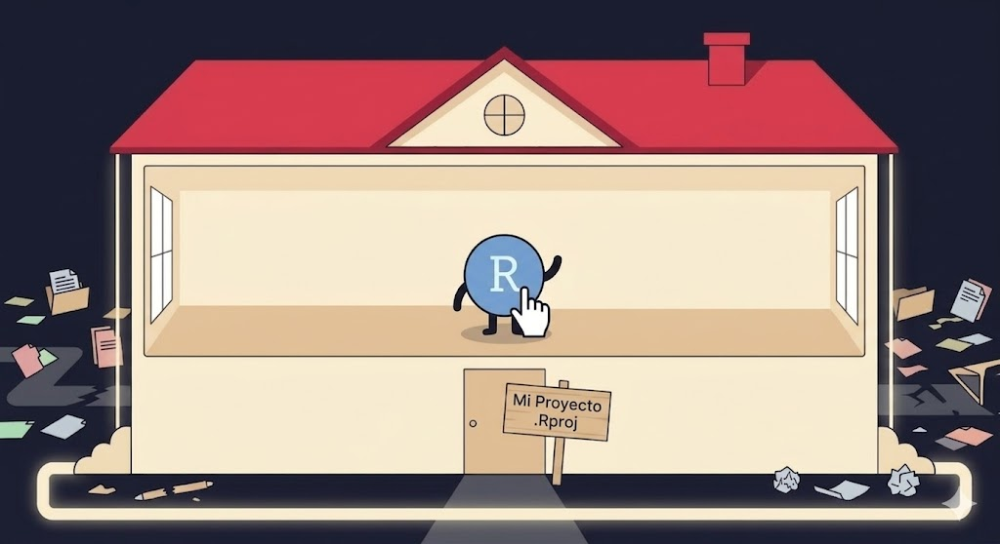
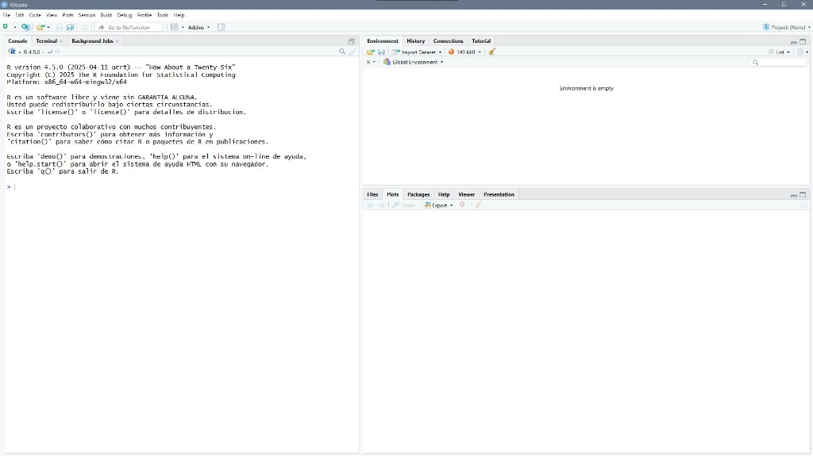
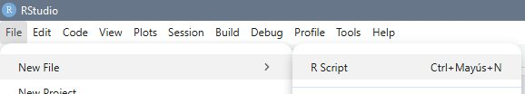
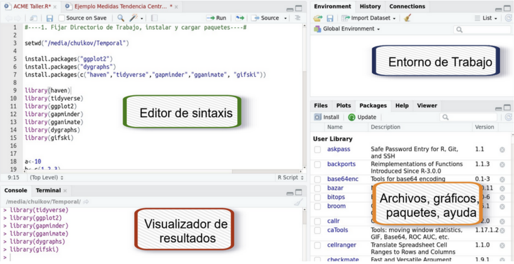
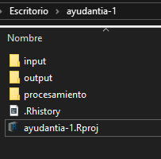
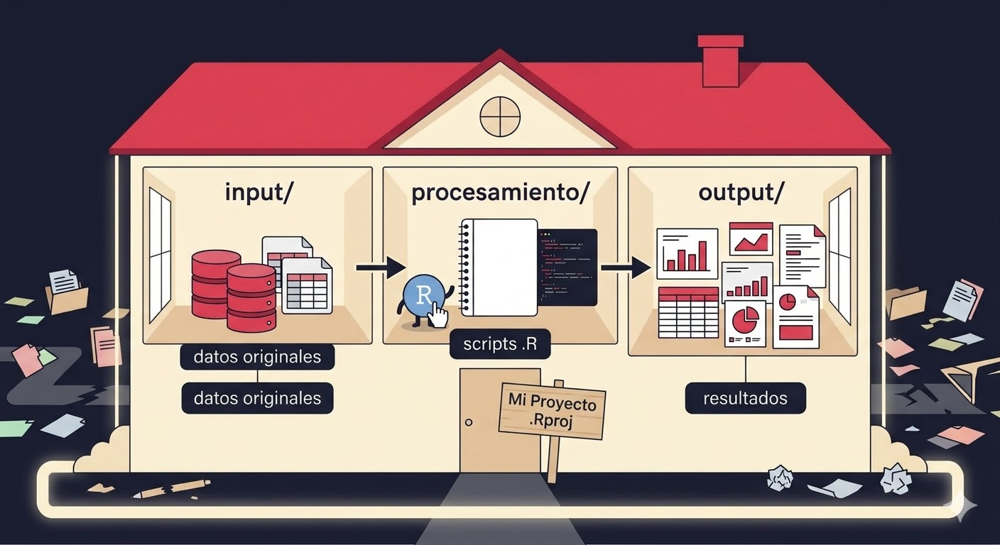

```{r setup}
#| include: false
source(here::here("R", "setup.R"))
```

## ¿Qué veremos hoy?

1.  Diagnóstico inicial
2.  El ecosistema de software
3.  ¿Qué es R y por qué usarlo?
4.  Conociendo RStudio
5.  Sistema de carpetas
6.  Cargar y explorar CASEN 2024

[Al final de la sesión vas a poder abrir una base de datos real y explorarla en R.]{.destacado}

# Diagnóstico inicial

## ¿Dónde estamos parados?

::: incremental
-   ¿Ya tienen R y RStudio instalados?
-   ¿Han usado antes algún software estadístico? (SPSS, Stata, Excel...)
-   ¿Tienen computador para traer a las próximas ayudantías?
:::

# El ecosistema de software

## ¿Qué herramienta uso para qué?

| Herramienta | ¿Qué es? | ¿Para qué se usa? |
|:--|:--|:--|
| **R** | Lenguaje estadístico | Análisis de datos, modelos, visualizaciones |
| **RStudio / Positron** | Entorno de trabajo (IDE) | Interfaz para escribir código en R |
| **Python** | Lenguaje de programación general | *Machine learning*, automatización, web |
| **VS Code** | Editor de código universal | Programar en cualquier lenguaje |

[En este curso usamos R + RStudio:]{.destacado} es el estándar en ciencias sociales cuantitativas, es gratuito y produce análisis reproducibles.

# ¿Qué es R y por qué usarlo?

## ¿Qué es R?

:::: columns
::: {.column width="55%"}
R es un **lenguaje de programación estadístico** de código abierto, creado en 1993 por Ross Ihaka y Robert Gentleman (Universidad de Auckland).

-   +20.000 paquetes en CRAN
-   Comunidad científica global
-   Completamente gratuito
-   Análisis **reproducibles**
:::

::: {.column width="45%"}
::: callout-tip
## ¿Qué significa reproducible?

Que otra persona puede tomar tu código y llegar exactamente al mismo resultado.
:::

R lo usan el INE, el Banco Mundial y el Ministerio de Desarrollo Social, entre muchas otras instituciones públicas.
:::
::::

## R vs. otros softwares

|                    |  R  | SPSS | Excel |
|:-------------------|:---:|:----:|:-----:|
| Gratuito           | ✅  |  ❌  |  ❌   |
| Reproducible       | ✅  |  ⚠️  |  ❌   |
| Código abierto     | ✅  |  ❌  |  ❌   |
| Gráficos avanzados | ✅  |  ⚠️  |  ⚠️   |

En administración pública, la **transparencia y reproducibilidad** de los análisis es cada vez más exigida.

# Trabajar ordenadamente

## Proyectos de R (`.Rproj`)

Vamos a trabajar dentro de **proyectos**: el proyecto es nuestro "hogar". El primer paso es construirlo.

{fig-align="center" width="60%"}

## Crear un proyecto

:::: columns
::: {.column width="40%"}
{width="80%"}
:::

::: {.column width="60%"}
1.  *File → New Project → New Directory → New Project*
2.  *Directory name*: un nombre sin espacios, por ej. `ayudantia-1`
3.  *Browse*: dónde guardarlo, por ej. "Métodos cuantitativos"
4.  *Create Project*
5.  ¡Tienen su primer proyecto en R!
:::
::::

## Un proyecto sin orden

{fig-align="center" width="60%"}

## Explorando RStudio por primera vez

{fig-align="center" width="70%"}

Al abrirlo verán **tres paneles**.

## Abrir un script

{fig-align="center" width="70%"}

*File → New File → R Script*, o `Ctrl + Shift + N`.

## Los 4 paneles de RStudio

:::: columns
::: {.column width="40%"}

:::

::: {.column width="60%" .chico}
| Panel | Ubicación | ¿Para qué sirve? |
|:--|:--|:--|
| **Script** | Arriba izquierda | Escribir y guardar tu código |
| **Consola** | Abajo izquierda | Ejecutar código y ver resultados |
| **Entorno** | Arriba derecha | Ver objetos y datos cargados |
| **Archivos / Gráficos** | Abajo derecha | Explorar carpetas y ver gráficos |
:::
::::

# Sistema de carpetas

## Cómo organizar tu trabajo: sistema IPO

:::: columns
::: {.column width="55%"}
**I**nput, **P**rocesamiento, **O**utput:

```
ayudantia-1/
├── ayudantia-1.Rproj
├── input/          datos originales
├── procesamiento/  scripts
└── output/         resultados
```

-   Siempre sabes dónde está cada cosa
-   Evita rutas de archivo rotas
-   Facilita el trabajo colaborativo
:::

::: {.column width="45%"}
{width="70%"}
:::
::::

## Así se ve ordenado

{fig-align="center" width="75%"}

## Primer contacto con R

Escribe en tu script y ejecuta con `Ctrl + Enter` (el cursor puede estar en cualquier parte de la línea):

:::: columns
::: {.column width="50%"}
```{r primer-codigo}
#| output-location: column
# R como calculadora
2 + 2
sqrt(144)
log(100)
```
:::

::: {.column width="50%"}
```{r objetos}
# Crear objetos con <-
caja <- "gatos"
caja

a <- 4
a * 5
```
:::
::::

[`<-` es el operador de asignación. Atajo: `Alt + -`]{.chico}

# Cargar y explorar CASEN 2024

## Instalar y cargar paquetes

```{r instalar}
#| eval: false
install.packages("tidyverse")   # instalar: SOLO UNA VEZ por computador
```

```{r cargar-paquete}
library(tidyverse)              # cargar: CADA VEZ que abres R
```

[Instalar un paquete es traerlo a tu computador; cargarlo es usarlo en esta sesión.]{.destacado}

## Cargar la base de datos

Guarda `casen_ay1.csv` en tu carpeta `input/` y luego:

```{r cargar-csv}
#| eval: false
casen <- read_csv("input/casen_ay1.csv")
```

```{r cargar-csv-local}
#| include: false
casen <- read_csv(ruta_datos("casen_ay1.csv"))
```

::: callout-note
La ruta `"input/casen_ay1.csv"` funciona porque trabajamos **dentro del proyecto**: R busca los archivos a partir de la carpeta del `.Rproj`.
:::

## Explorar la base

```{r explorar}
dim(casen)       # filas (casos) y columnas (variables)
glimpse(casen)   # nombre, tipo y primeros valores de cada variable
```

## Primeras preguntas a los datos

:::: columns
::: {.column width="50%"}
```{r frecuencias}
# ¿Cuántas personas por sexo?
count(casen, sexo)

# ¿Y por condición de pobreza?
count(casen, pobreza)
```
:::

::: {.column width="50%"}
```{r promedio}
# Promedio de edad
mean(casen$edad, na.rm = TRUE)

# Pobreza según sexo
count(casen, sexo, pobreza)
```
:::
::::

[`na.rm = TRUE` le dice a R que ignore los valores perdidos (`NA`) al calcular.]{.chico}

# ¡Nos vemos en la siguiente sesión!
