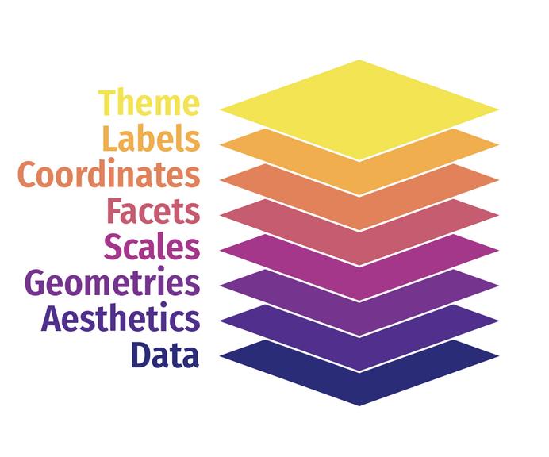

```{r setup}
#| include: false
source(here::here("R", "setup.R"))
```

## ¿Qué veremos hoy?

1.  Cargar los datos procesados en la AY-2
2.  Tablas de frecuencia
3.  Estadísticos descriptivos por grupo
4.  Tablas listas para reportar en una línea
5.  Gráficos con `ggplot2`
6.  Práctica autónoma

[Al final de la sesión sabrás generar tablas y gráficos listos para un informe.]{.destacado}

# Punto de partida

## ¿Qué hicimos en la AY-2?

-   Seleccionamos y renombramos variables con `select()`
-   Recodificamos con `mutate()` + `factor()`
-   Convertimos -88 y -99 en `NA`
-   Creamos tramos con `case_when()` e `if_else()`
-   Guardamos la base con `saveRDS()`

**Hoy retomamos desde ahí:** describir, cruzar y visualizar.

## Paquetes y datos

```{r paquetes}
pacman::p_load(
  tidyverse,   # manipulación de datos y gráficos (dplyr, ggplot2)
  janitor,     # tablas cruzadas rápidas (tabyl)
  gt,          # tablas con formato para informes
  gtsummary,   # tablas descriptivas en una línea
  sjmisc       # frecuencias rápidas (frq)
)
```

```{r cargar}
#| eval: false
# Opción 1: desde tu carpeta output/
casen_proc <- readRDS("output/casen_proc.rds")

# Opción 2: desde GitHub
casen_proc <- readRDS(gzcon(url("https://github.com/Cristobal-Mejias-G/metodos-cuantitativos-fagob/raw/main/datos/casen_proc.rds")))
```

```{r cargar-local}
#| include: false
casen_proc <- readRDS(ruta_datos("casen_proc.rds"))
```

# Tablas de frecuencia

## La lógica: procesar → formatear

| Paso | Herramienta | ¿Para qué? |
|:--|:--|:--|
| 1. Procesar | `dplyr` | Calcular frecuencias, medias, porcentajes |
| 2. Formatear | `gt` | Título, nombres de columnas, separador de miles, fuente |

## Paso 1: procesar con `count()`

```{r tab-pobreza}
#| output-location: column
tab_pobreza <- casen_proc |>
  count(pobreza) |>
  mutate(porcentaje = n / sum(n) * 100)

tab_pobreza
```

[`count()` resume en una línea lo que antes hacíamos con `group_by()` + `summarise(n = n())`.]{.chico}

## Paso 2: formatear con `gt`

```{r tabla1}
#| output-location: column
tab_pobreza |>
  gt() |>
  cols_label(
    pobreza    = "Situación de pobreza",
    n          = "N",
    porcentaje = "%"
  ) |>
  fmt_number(porcentaje, decimals = 1,
             dec_mark = ",") |>
  tab_header("Distribución por situación de pobreza") |>
  tab_source_note("Fuente: elaboración propia en base a CASEN 2024.")
```

## Tablas cruzadas: `janitor::tabyl()`

```{r tabyl}
#| output-location: column
casen_proc |>
  tabyl(pobreza, sexo) |>
  adorn_totals("row") |>
  adorn_percentages("col") |>
  adorn_pct_formatting(digits = 1) |>
  adorn_ns()
```

[Cada `adorn_*()` agrega una capa: totales, porcentajes por columna, formato y los N entre paréntesis.]{.chico}

# Descriptivos por grupo

## Variable numérica según una categórica

```{r tab-ingreso}
tab_ingreso <- casen_proc |>
  group_by(sexo) |>
  summarise(
    n       = n(),
    media   = mean(ingreso, na.rm = TRUE),
    de      = sd(ingreso, na.rm = TRUE),
    mediana = median(ingreso, na.rm = TRUE)
  )
```

```{r tabla2}
#| output-location: fragment
tab_ingreso |>
  gt() |>
  cols_label(sexo = "Sexo", n = "N", media = "Media", de = "DE", mediana = "Mediana") |>
  fmt_number(c(media, de, mediana), decimals = 0, sep_mark = ".") |>
  tab_header("Ingreso laboral según sexo")
```

## El mismo patrón con otra agrupación

```{r tabla3}
#| output-location: column
casen_proc |>
  group_by(tramo_edad) |>
  summarise(
    n       = n(),
    media   = mean(ingreso, na.rm = TRUE),
    mediana = median(ingreso, na.rm = TRUE)
  ) |>
  gt() |>
  fmt_number(c(media, mediana),
             decimals = 0, sep_mark = ".") |>
  tab_header("Ingreso laboral según tramo etario")
```

## Tablas listas en una línea: `gtsummary`

```{r gtsummary}
#| output-location: column
theme_gtsummary_language("es",
                         big.mark = ".",
                         decimal.mark = ",")

casen_proc |>
  select(sexo, edad, ingreso,
         tramo_edad) |>
  tbl_summary(by = sexo)
```

[Detecta solo si cada variable es categórica (N y %) o numérica (mediana y rango intercuartílico).]{.chico}

# Gráficos con `ggplot2`

## La lógica de `ggplot2`: capas

{fig-align="center" width="55%"}

| Capa | Función | ¿Para qué? |
|:--|:--|:--|
| 1. Datos y ejes | `ggplot(datos, aes(...))` | El lienzo |
| 2. Geometría | `geom_*()` | La forma: barras, puntos, cajas |
| 3. Etiquetas | `labs()` | Títulos, ejes, leyenda |
| 4. Estética | `theme_*()`, `scale_*()` | El estilo visual |

## Barras: frecuencia de una variable

```{r graf-barras}
#| output-location: column
#| fig-width: 6
#| fig-height: 5
ggplot(casen_proc,
       aes(x = pobreza, fill = pobreza)) +
  geom_bar() +
  scale_fill_manual(values = c(
    "#d73027", "#f46d43", "#fdae61", "#4575b4"
  )) +
  labs(
    title   = "Situación de pobreza",
    x       = NULL,
    y       = "Frecuencia",
    caption = "Fuente: CASEN 2024."
  ) +
  theme(legend.position = "none") +
  coord_flip()
```

## Barras agrupadas: dos variables categóricas

:::: columns
::: {.column width="50%"}
```{r graf-dodge}
#| fig-height: 5
ggplot(casen_proc,
       aes(x = tramo_ingreso, fill = sexo)) +
  geom_bar(position = "dodge") +
  labs(x = "Tramo de ingreso",
       y = "Frecuencia", fill = "Sexo")
```
:::

::: {.column width="50%"}
```{r graf-fill}
#| fig-height: 5
ggplot(casen_proc,
       aes(x = tramo_ingreso, fill = sexo)) +
  geom_bar(position = "fill") +
  scale_y_continuous(labels = scales::label_percent()) +
  labs(x = "Tramo de ingreso",
       y = "Porcentaje", fill = "Sexo")
```
:::
::::

[`"dodge"` pone las barras lado a lado; `"fill"` las apila al 100%, útil para comparar proporciones.]{.chico}

## Boxplot: variable continua por grupo

```{r graf-boxplot}
#| output-location: column
#| fig-width: 6
#| fig-height: 5
casen_proc |>
  drop_na(ingreso) |>
  ggplot(aes(x = sexo, y = ingreso,
             fill = sexo)) +
  geom_boxplot(alpha = 0.7) +
  scale_y_continuous(
    labels = scales::label_dollar(big.mark = ".")
  ) +
  labs(title = "Ingreso laboral según sexo",
       x = NULL, y = "Ingreso") +
  theme(legend.position = "none")
```

## Dispersión con línea de tendencia

```{r graf-dispersion}
#| output-location: column
#| fig-width: 6
#| fig-height: 5
casen_proc |>
  drop_na(ingreso) |>
  ggplot(aes(x = edad, y = ingreso)) +
  geom_point(alpha = 0.2) +
  geom_smooth(method = "lm") +
  scale_y_continuous(
    labels = scales::label_dollar(big.mark = ".")
  ) +
  labs(title = "Edad e ingreso laboral",
       x = "Edad", y = "Ingreso")
```

[`geom_smooth(method = "lm")` agrega la recta de regresión con su intervalo de confianza al 95%.]{.chico}

## Para seguir aprendiendo

-   [R for Data Science (2e): visualización](https://r4ds.hadley.nz/data-visualize.html)
-   [Documentación de ggplot2](https://ggplot2.tidyverse.org/)
-   [Documentación de gt](https://gt.rstudio.com/) y [gtsummary](https://www.danieldsjoberg.com/gtsummary/)

# Práctica autónoma

## Tu turno (10 min)

Con `casen_proc`, trabaja con **`actividad`**, **`tramo_edad`** e **`ingreso_pc`**.

::: ejercicio
1.  Tabla de frecuencias de `actividad` con `count()` + `gt()`: N, porcentaje, título y fuente
2.  Tabla de `ingreso_pc` por `tramo_edad`: n, media, desviación estándar y mediana
3.  Boxplot de `ingreso_pc` según `actividad`
4.  Extra: compara tus tablas con `tbl_summary(by = actividad)`
:::

## Resumen de la sesión

| Tarea | Función(es) |
|:--|:--|
| Frecuencias | `count()` + `mutate()` |
| Tablas cruzadas | `tabyl()` + `adorn_*()` |
| Descriptivos por grupo | `group_by()` + `summarise()` |
| Formato para informe | `gt()`, `fmt_number()`, `tab_header()` |
| Tabla descriptiva rápida | `tbl_summary()` |
| Barras / boxplot / dispersión | `geom_bar()`, `geom_boxplot()`, `geom_point()` + `geom_smooth()` |

# ¡Nos vemos en la siguiente sesión!
