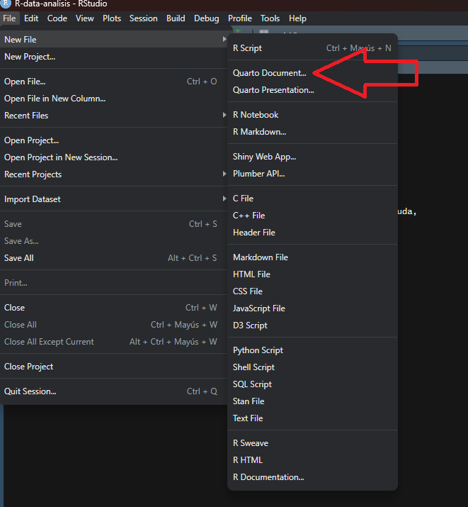
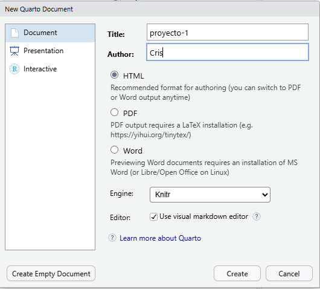
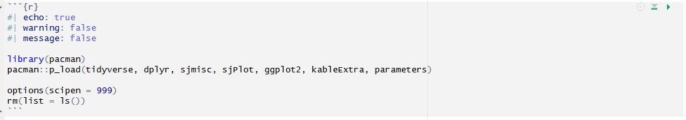

```{r setup}
#| include: false
source(here::here("R", "setup.R"))
```

# ¿Por qué documentos dinámicos?

En el trabajo cuantitativo, el flujo habitual consiste en correr código en R, copiar resultados a un procesador de texto, ajustar manualmente tablas y gráficos, y repetir el ciclo cada vez que algo cambia. Este proceso es lento, propenso a errores y dificulta la **reproducibilidad**: la capacidad de que cualquier persona pueda llegar exactamente a los mismos resultados a partir de los mismos datos y procedimientos.

Los **documentos dinámicos** resuelven este problema al integrar en un solo archivo el texto, el código y los resultados del análisis. Si los datos cambian, el documento se actualiza automáticamente al renderizarlo.

## Reproducibilidad

Un análisis es reproducible cuando:

-   El código fuente está disponible y documentado.
-   Los datos de entrada están accesibles o descritos con precisión.
-   El entorno de trabajo (paquetes, versiones) está registrado.
-   Cualquier persona puede llegar al mismo resultado siguiendo los mismos pasos.

## Markdown vs. Quarto

| Concepto | Descripción |
|:--|:--|
| **Markdown** | Texto plano con marcas mínimas de formato (`.md`). Solo texto y estructura. |
| **R Markdown** | Markdown con código R ejecutable (`.Rmd`). Específico para R. |
| **Quarto** | Sistema moderno y multilenguaje (R, Python, Julia) para documentos dinámicos (`.qmd`). Estándar del curso. |

# Nuestro primer archivo `.qmd`

## Creación del archivo

1.  *File → New File → Quarto Document...*



2.  Escribimos un título y autor/a, y hacemos clic en *Create*.



## Escritura en Markdown

Todo el texto de un archivo `.qmd` se escribe en Markdown.

| Código | Resultado |
|:--|:--|
| `**negrita**` | **negrita** |
| `*cursiva*` | *cursiva* |
| `# Título 1` | Encabezado de nivel 1 |
| `## Título 2` | Encabezado de nivel 2 |
| `[texto](https://www.markdownguide.org/)` | [texto](https://www.markdownguide.org/) |
| `` | {width="80"} |
| `> cita` | cita en bloque |
| `- ítem` | lista |
| `1. ítem` | lista numerada |

## Código: los *chunks*

Para escribir código en un documento Quarto creamos un **chunk**: con `Ctrl + Alt + I` o en *Code → Insert Chunk*.



-   Los chunks comienzan y terminan con tres comillas invertidas (```` ``` ````).
-   `{r}` indica el lenguaje: en este caso, R.
-   Las opciones se escriben al inicio del chunk con `#|`. Si no se indica nada, se aplican los valores por defecto.

| Opción | Descripción |
|:--|:--|
| `echo` | Muestra u oculta el código |
| `eval` | Ejecuta o no el código |
| `output` | Incluye o excluye los resultados |
| `warning` | Muestra u oculta advertencias |
| `message` | Muestra u oculta mensajes |
| `include` | Suprime código y resultados a la vez |
| `label` | Identifica el chunk para referencias cruzadas |
| `fig-cap` | Título para gráficos (con `label: fig-...`) |
| `tbl-cap` | Título para tablas (con `label: tbl-...`) |

## Referencias cruzadas

1.  **Etiqueta:** las tablas llevan `label: tbl-nombre` y los gráficos `label: fig-nombre`. Así Quarto las numera.
2.  **Referencia:** en el texto se escribe `@tbl-nombre` y Quarto lo reemplaza por "Tabla 1", "Tabla 2", etc. La numeración depende del orden de aparición en el documento.
3.  **Texto personalizado:** `[ver resumen de datos](#tbl-nombre)` crea un enlace con el texto que elijas.

::: callout-tip
Haz todo el procesamiento en un chunk al inicio del documento y guarda los resultados en objetos. Luego, donde quieras que aparezca cada tabla, crea un chunk pequeño con solo el `label`, el `tbl-cap` y el nombre del objeto.
:::

# Aplicación práctica: estatus social subjetivo

## Preparación

Un chunk sin opciones muestra todos los mensajes al cargar paquetes:

```{r}
#| message: true
#| warning: true
pacman::p_load(tidyverse, sjmisc, sjPlot)
```

Para ocultarlos agregamos `#| message: false` y `#| warning: false`:

```{r}
#| message: false
#| warning: false
pacman::p_load(tidyverse, sjmisc, sjPlot, knitr)
```

## Carga de datos

```{r}
#| eval: false
load(url("https://github.com/Cristobal-Mejias-G/metodos-cuantitativos-fagob/raw/main/datos/issp_2009_chile.RData"))
```

```{r}
#| include: false
load(ruta_datos("issp_2009_chile.RData"))
```

```{r}
glimpse(issp)
```

## Tabla descriptiva

```{r}
#| label: tbl-desc
#| tbl-cap: "Estadísticos descriptivos de variables seleccionadas"
descr(issp, show = c("label", "range", "mean", "sd", "NA.prc", "n")) |>
  kable(digits = 2)
```

La @tbl-desc resume las variables con las que trabajaremos.

## Modelos de regresión lineal

```{r}
modelo_1 <- lm(topbot ~ educyrs, data = issp)
modelo_2 <- lm(topbot ~ educyrs + income, data = issp)
```

```{r}
#| label: tbl-reg
#| tbl-cap: "Modelos de regresión: estatus social subjetivo"
tab_model(
  modelo_1, modelo_2,
  show.ci     = FALSE,
  show.se     = TRUE,
  dv.labels   = c("Modelo 1", "Modelo 2"),
  pred.labels = c("(Intercepto)", "Años de educación", "Decil de ingreso")
)
```

## Visualización

```{r}
#| label: fig-ess
#| fig-cap: "Relación entre educación y estatus social subjetivo"
ggplot(issp, aes(x = educyrs, y = topbot)) +
  geom_jitter(alpha = 0.2, color = "#40666e", width = 0.3, height = 0.3) +
  geom_smooth(method = "lm", color = "#D49A3B", linewidth = 1.2) +
  labs(
    x       = "Años de educación",
    y       = "Estatus social subjetivo (1–10)",
    caption = "Fuente: elaboración propia en base a ISSP 2009."
  )
```

La @fig-ess muestra la asociación positiva entre años de escolaridad y estatus percibido.

# De documento a presentación

El mismo archivo puede convertirse en distintos formatos cambiando el YAML.

| Formato | YAML |
|:--|:--|
| Documento HTML | `format: html` |
| Word | `format: docx` |
| Presentación | `format: revealjs` |

En una presentación, los encabezados `#` y `##` crean diapositivas automáticamente. También se puede usar `---` para separarlas manualmente.

``` yaml
format:
  revealjs:
    theme: simple
    slide-number: true
    incremental: true
```

::: callout-note
Las presentaciones de estas ayudantías están hechas así: cada una es un `.qmd` con `format: fagob-revealjs`. Puedes ver su código en el [repositorio](https://github.com/Cristobal-Mejias-G/metodos-cuantitativos-fagob).
:::

# Recursos para profundizar

-   [Creación de documentos científicos con Quarto](https://aprendeconalf.es/quarto-textos-cientificos/)
-   [Documentación oficial de Quarto](https://quarto.org/)
-   [Video tutorial](https://www.youtube.com/watch?v=EbAAmrB0luA)
