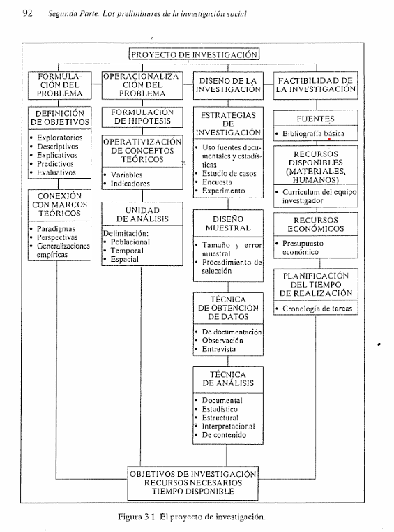
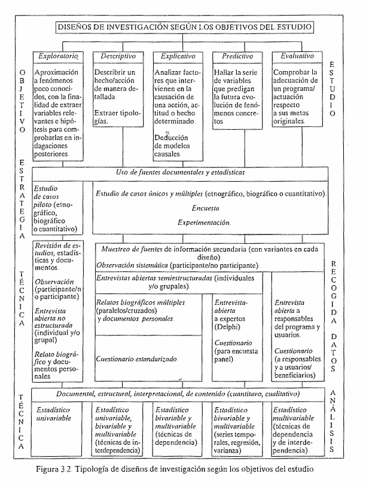
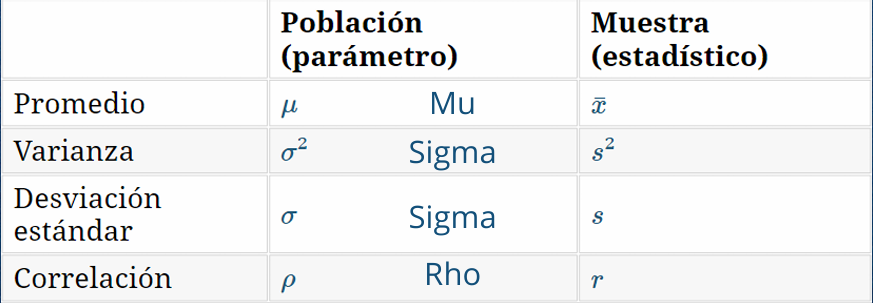
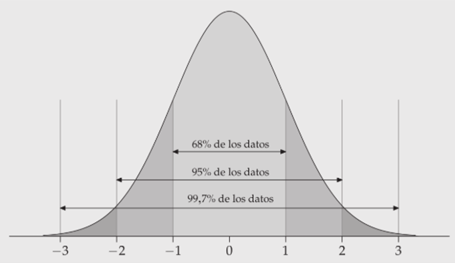
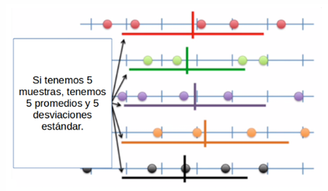
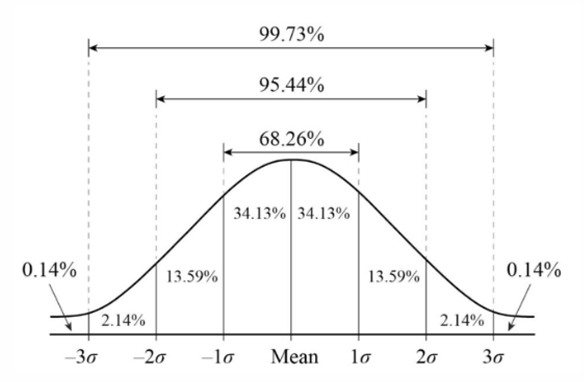
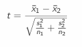
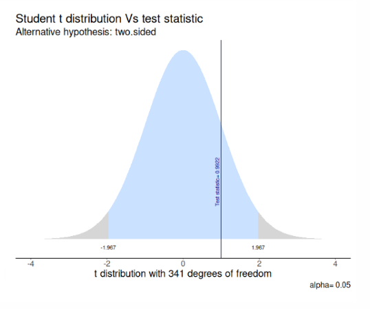

```{r setup}
#| include: false
source(here::here("R", "setup.R"))
```

## ¿Qué veremos hoy?

1.  Repaso de las primeras unidades (30 minutos)
2.  Repaso de inferencia (40 minutos)
3.  Aplicación (20 minutos)

# Unidad 1

## Investigación cuantitativa

-   ¿Qué la diferencia?
-   ¿Cuáles son sus principales desafíos?

**Lecturas:** Raadschelders (2011), Ramos (2016). ¿Qué podemos rescatar de estos textos?

# Unidad 2

## Problema y diseño de investigación

-   ¿Cómo se formula un problema?
-   ¿Cuáles son los tipos de diseño y sus diferencias?

**Lecturas:** Cea (2001), Hernández (2014), Bellei (2013).

## Del problema a los objetivos

:::: columns
::: {.column width="50%"}
{width="75%"}
:::

::: {.column width="50%"}
{width="75%"}
:::
::::

# Unidad 3

## Medición

-   ¿Cómo se miden los números?
-   ¿Algunos ejemplos?
-   ¿Cómo se construyen los indicadores?

# Unidad 4

## Conceptos clave

:::: columns
::: {.column width="40%"}
-   Población
-   Muestra
-   Inferencia
-   Distribución
:::

::: {.column width="60%"}

:::
::::

## Curva normal

{fig-align="center" width="70%"}

## Distribución muestral del promedio

:::: columns
::: {.column width="55%"}

:::

::: {.column width="45%"}
$$SE = \frac{s}{\sqrt{n}}$$

El error estándar se calcula para el promedio, la diferencia de promedios, la correlación, etc.
:::
::::

## Intervalos de confianza

-   Rango de valores dentro del cual se espera que se encuentre un parámetro poblacional, con cierto nivel de confianza.
-   Requiere fijar un nivel de confianza (en puntaje Z).
-   Se construye sumando y restando errores estándar al estimador.

| Confianza | Error | Z |
|:--:|:--:|:--:|
| 68% | 32% | 1 |
| 95% | 5% | 1,96 |
| 99% | 1% | 2,58 |

[Más confianza implica un intervalo más amplio (menos preciso).]{.destacado}

## ¿De dónde salen 1,96 y 2,58?

R calcula el puntaje Z que deja un área dada en las colas de la curva normal:

```{r qnorm}
qnorm(0.975)   # 95%: deja 2,5% en cada cola
qnorm(0.995)   # 99%: deja 0,5% en cada cola
```

{fig-align="center" width="45%"}

## Práctico 1 (8 minutos)

::: ejercicio
En un Índice de Satisfacción Usuaria (0–100) de un servicio estatal, el promedio es 55 puntos con un error estándar de 8 puntos.

Construya un IC al 95% y otro al 99%, y compárelos.
:::

## Verificar el cálculo con R

```{r ic-practico}
#| output-location: fragment
promedio <- 55
se <- 8

c(inferior = promedio - 1.96 * se, superior = promedio + 1.96 * se)   # 95%
c(inferior = promedio - 2.58 * se, superior = promedio + 2.58 * se)   # 99%
```

## Prueba de hipótesis: pasos

1.  Formular hipótesis
2.  Obtener el error estándar y el estadístico de prueba
3.  Establecer la probabilidad de error
4.  Calcular el IC o contrastar el valor empírico con el crítico
5.  Interpretar

## Tipos de hipótesis

| Pregunta | $H_0$ | $H_1$ | Prueba |
|:--|:--|:--|:--|
| ¿Existe el promedio en la población? | $\bar{x} = 0$ | $\bar{x} \neq 0$ | Dos colas |
| ¿Hay diferencia de promedios en la población? | $\bar{x}_1 - \bar{x}_2 = 0$ | $\bar{x}_1 - \bar{x}_2 \neq 0$ | Dos colas |

## Prueba t: empírico vs. crítico

:::: columns
::: {.column width="50%"}
**t crítico** depende del nivel de confianza:

-   95%: 1,96
-   99%: 2,58

**t empírico** para diferencia de medias:

{width="50%"}
:::

::: {.column width="50%"}
Si el t empírico cae en la **zona de rechazo** (mayor que el t crítico), rechazamos $H_0$ y tenemos evidencia a favor de $H_1$.

{width="70%"}
:::
::::

# Aplicación

## Aplicación 2: satisfacción laboral

Se compara el puntaje promedio de satisfacción laboral entre trabajadores/as con jornada completa y parcial:

| Dato | Valor |
|:--|:--:|
| Tamaño muestral | 500 |
| Promedio jornada completa | 74 |
| Promedio jornada parcial | 66 |
| Error estándar de la diferencia | 4 |
| t crítico (α = 0,05 / 0,01) | 1,96 / 2,58 |
| t empírico | 2 |

## Preguntas

::: ejercicio
1.  Formule la hipótesis nula y la alternativa para la diferencia de promedios entre jornada completa y parcial.
2.  Contrastando el t crítico y el empírico: ¿es posible rechazar la hipótesis nula? ¿Con qué nivel de confianza?
3.  Construya un intervalo al 95% para la diferencia de promedios e interprételo.
:::

# Cierre

## Preparación para la prueba

-   Repasar las principales lecturas
-   Estudiar ejemplos aplicados a la administración pública

# ¡Nos vemos en la siguiente sesión!
