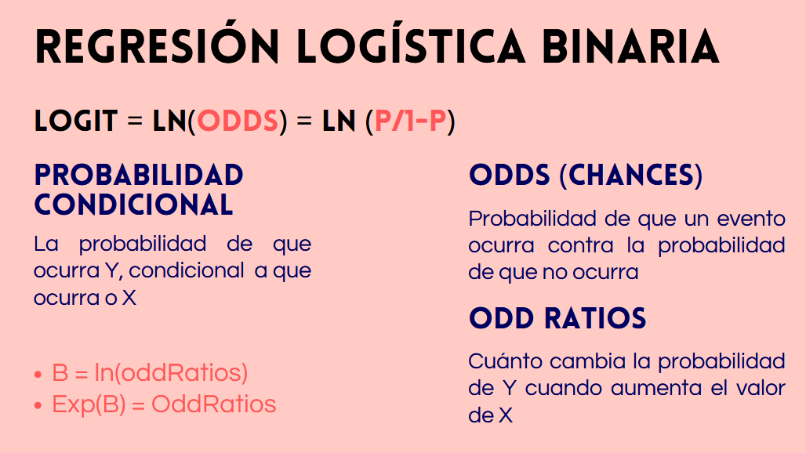

```{r setup}
#| include: false
source(here::here("R", "setup.R"))
```

## Estructura de la sesión

Repasamos los contenidos centrales de la última etapa del curso antes de la evaluación final.

1.  Regresión logística: fundamentos, interpretación y ajuste
2.  Análisis de Componentes Principales (ACP): objetivos, criterios y resultados
3.  Diseño de cuestionario: estructura, tipos de preguntas y ética

# 1 · Regresión logística

## ¿Cuándo usar regresión logística?

Cuando la **variable dependiente es dicotómica**: toma solo dos valores (1 = participó / 0 = no participó; 1 = aprobó / 0 = reprobó).

**¿Por qué no usar regresión lineal (MCO)?**

-   Puede producir **predicciones fuera del rango [0, 1]**, imposibles para una probabilidad.
-   La relación real entre la probabilidad y una variable independiente tiene forma **sigmoidal**, no lineal.

La regresión logística modela directamente la **probabilidad** del evento, manteniendo las predicciones entre 0 y 1.

## La cadena de transformaciones

1.  **Probabilidad** ($p$): posibilidad de que ocurra el evento.
2.  **Odds (chances):** razón entre la probabilidad de que ocurra y la de que no ocurra: $\text{Odds} = \frac{p}{1 - p}$
3.  **Logit:** logaritmo natural de los odds, que el modelo estima en escala lineal:

$$\text{logit}(p) = \ln\left(\frac{p}{1-p}\right) = \beta_0 + \beta_1 X_1 + \cdots + \beta_k X_k$$

Para volver a probabilidades: $p = \frac{e^{\text{logit}}}{1 + e^{\text{logit}}}$

## Interpretación de coeficientes: tres formas

::: chico
| Forma | Cómo se obtiene | Interpretación |
|:--|:--:|:--|
| **Log-odds** ($\beta$) | Directamente del modelo | Cambio en el logaritmo de los odds por unidad de $X$. Difícil de interpretar. |
| **Odds ratio** (OR) | $e^{\beta}$ | Cuántas veces más (o menos) son las chances del evento por unidad de $X$. OR \> 1 aumenta; OR \< 1 disminuye. |
| **Probabilidad predicha** | Función logística aplicada al logit | La forma más intuitiva: se fijan valores de las variables y se convierte a probabilidad. |
:::

**Ejemplo:** si el OR de ser mujer es 11,78, las mujeres tienen 11,78 veces más chances de experimentar el evento que los hombres (referencia), manteniendo constantes las demás variables.

##

{fig-align="center"}

## Evaluación del ajuste

En regresión logística **no se usa el $R^2$ de MCO**. Las medidas se basan en la **log-verosimilitud** ($\ell$):

::: chico
| Medida | Descripción |
|:--|:--|
| **Devianza** | Cuantifica los residuos del modelo. Menor devianza = mejor ajuste. |
| **Test LRT** | Compara modelos anidados: $G^2 = -2(\ell_{\text{restringido}} - \ell_{\text{completo}})$, con distribución $\chi^2$ (gl = parámetros añadidos). |
| **AIC** | Penaliza por número de variables; permite comparar modelos no anidados. **Menor AIC = mejor modelo.** |
| **Pseudo $R^2$ de McFadden** | Compara con un modelo nulo. Entre 0,2 y 0,4 se considera aceptable; **no** se interpreta como el $R^2$ lineal. |
:::

## En R: `glm()` con `family = binomial`

``` r
modelo <- glm(y ~ x1 + x2 + x3, data = datos, family = binomial)
```

| Para obtener... | Código |
|:--|:--|
| Coeficientes en log-odds | `summary(modelo)` |
| Odds ratios con IC | `parameters::model_parameters(modelo, exponentiate = TRUE)` |
| Probabilidades predichas | `ggeffects::predict_response(modelo, terms = "x1")` |
| Pseudo $R^2$, AIC | `performance::model_performance(modelo)` |

## Ejemplo: probabilidad de pobreza (CASEN 2024)

```{r logit-datos}
#| include: false
pacman::p_load(tidyverse, parameters, ggeffects, performance)
casen_proc <- readRDS(ruta_datos("casen_proc.rds"))
```

```{r logit}
casen_logit <- casen_proc |>
  mutate(pobre = if_else(pobreza == "No pobre", 0, 1))   # 1 = cualquier tipo de pobreza

modelo_pobreza <- glm(pobre ~ sexo + edad + horas_trab,
                      data = casen_logit, family = binomial)

model_parameters(modelo_pobreza, exponentiate = TRUE) |>
  print_md()
```

## Probabilidades predichas

```{r logit-pred}
#| fig-width: 9
#| fig-height: 4.5
#| fig-align: center
predict_response(modelo_pobreza, terms = c("horas_trab", "sexo")) |>
  plot() +
  labs(title = NULL, x = "Horas trabajadas a la semana", y = "Probabilidad de pobreza")
```

# 2 · Análisis de Componentes Principales (ACP)

## ¿Qué es el ACP? {.chico}

Método **multivariante, exploratorio y descriptivo**. Busca explicar $p$ variables observables mediante un número menor $k$ de **componentes principales**, con la menor pérdida de información posible.

**¿Para qué sirve?**

-   **Reducir dimensiones:** sintetizar muchas variables en pocos componentes interpretables.
-   **Construir indicadores sintéticos:** un puntaje que resume varias dimensiones (por ejemplo, capacidad institucional).
-   **Resolver multicolinealidad:** reemplazar variables muy correlacionadas por componentes independientes entre sí.
-   **Representar gráficamente** datos complejos en dos o tres dimensiones.

[El ACP no busca relaciones causales: agrupa variables, no establece dependencias.]{.destacado}

## ACP vs. análisis factorial

::: chico
| Criterio | ACP | Análisis factorial (AFE) |
|:--|:--|:--|
| **Varianza considerada** | Total | Común (comunalidad) |
| **Naturaleza** | Combinaciones lineales de las variables originales | Modelo con dimensiones latentes "ocultas" |
| **Dirección** | Los componentes se explican por las variables | Las variables dependen de los factores |
| **Uso habitual** | Reducción de datos, indicadores sintéticos | Validación de escalas, psicometría |
:::

Para **reducir variables** se prefiere el ACP; para **identificar rasgos latentes** no observables, el AFE.

## Requisitos para aplicar ACP

1.  **Correlación entre variables:** si son independientes no hay información común que reducir. Se verifica con la prueba de Bartlett o el índice KMO.
2.  **Nivel de medición:** variables cuantitativas (intervalo o razón). En la práctica se aceptan ordinales con al menos 5 categorías.
3.  **Tamaño muestral:** mínimo recomendado de 150 a 200 casos.
4.  **Estandarización:** si las escalas difieren, se analiza la **matriz de correlaciones**.

## Criterios para retener componentes

::: chico
| Criterio | Descripción |
|:--|:--|
| **Regla de Kaiser** | Retener componentes con **valor propio \> 1**: explican más varianza que una variable original. |
| **Varianza acumulada** | Retener los suficientes para cubrir entre el **70% y 90%** de la varianza total. |
| **Gráfico de sedimentación** | Valores propios en orden descendente; se retienen los anteriores al **"codo"**. |
| **Interpretabilidad** | **El criterio más importante.** Los componentes deben tener sentido teórico y poder nombrarse. |
:::

Se usan varios criterios en conjunto; cuando hay conflicto, la interpretabilidad decide.

## Cargas e interpretación

Las **cargas** son las correlaciones entre cada variable original y cada componente. Para interpretar un componente:

1.  Identificar las variables con cargas altas **en valor absoluto** (convención: \|carga\| ≥ 0,40 o 0,50).
2.  Observar el **signo**: cargas de signo opuesto indican que las variables se mueven en direcciones contrarias.
3.  Proponer un **nombre sustantivo** para la dimensión que une a esas variables.

## Puntuaciones factoriales

Cada observación recibe un **puntaje** en cada componente retenido: variables nuevas, continuas y **no correlacionadas entre sí**.

-   **Indicador sintético:** un índice que resume las variables originales.
-   **Insumo para regresión:** reemplaza variables correlacionadas y elimina la multicolinealidad.
-   **Agrupamiento (*clustering*):** permite agrupar observaciones en menos dimensiones.

[Precaución: la interpretación de los componentes depende del analista y debe respaldarse teóricamente.]{.chico}

## Ejemplo en R: percepción de conflictos (ISSP 2009)

```{r acp-datos}
#| include: false
load(ruta_datos("issp_2009_chile.RData"))
```

```{r acp}
#| output-location: column
conflictos <- issp |>
  select(conflict_rp, conflict_wcmc,
         conflict_mw, conflict_tb) |>
  drop_na()

acp <- prcomp(conflictos, scale. = TRUE)

summary(acp)   # varianza por componente
acp$rotation   # cargas
```

## Gráfico de sedimentación

```{r scree}
#| fig-width: 8
#| fig-height: 4.5
#| fig-align: center
factoextra::fviz_eig(acp, addlabels = TRUE, choice = "eigenvalue") +
  geom_hline(yintercept = 1, linetype = "dashed") +   # regla de Kaiser
  labs(title = NULL, x = "Componente", y = "Valor propio")
```

# 3 · Diseño de cuestionario

## Encuesta vs. cuestionario

-   **Encuesta social:** el **proceso de investigación completo**: diseño, aplicación, recolección y análisis. Implica una interacción asimétrica entre quien investiga (conduce) y quien responde (su habla está delimitada por el instrumento).
-   **Cuestionario:** el **instrumento**: el conjunto de preguntas y respuestas predefinidas.

**¿Cuándo construir un cuestionario propio?** Solo si no hay fuentes secundarias adecuadas (CASEN, CEP, Encuesta Mundial de Valores) o si se requiere medir constructos que esas fuentes no cubren. Construirlo tiene **altos costos de tiempo y recursos**.

## Modos de aplicación

::: chico
| Modo | Ventajas | Desventajas |
|:--|:--|:--|
| **Cara a cara** | Mayor control, menor rechazo, permite aclarar dudas | Mayor costo; sesgo del entrevistador en temas íntimos |
| **Telefónico** | Menor costo, amplia cobertura geográfica | Mayor rechazo; no permite material visual |
| **Autoaplicado (papel)** | Ideal para temas sensibles; reduce sesgo del entrevistador | Requiere instrucciones muy claras; depende del nivel de lectura |
| **Autoaplicado (internet)** | Bajo costo, rapidez | Sesgo de selección: solo quienes tienen acceso y habilidad digital |
:::

El modo afecta la redacción, la extensión del instrumento y los sesgos a controlar.

## Estructura del cuestionario

::: chico
Un orden lógico que construye confianza progresivamente:

A)  **Presentación:** propósito del estudio, garantía de anonimato. Breve y no intimidante.
B)  **Preguntas filtro:** verifican los criterios de inclusión (edad, cargo, territorio).
C)  **Identificación no intrusiva:** sexo, edad, nivel educativo.
D)  **Cuerpo:** los constructos centrales, de lo **simple y general** a lo **complejo o privado**.
E)  **Identificación intrusiva y cierre:** preguntas sensibles (ingresos, bienes, situación laboral) al final, cuando ya hay confianza. Cerrar agradeciendo.
:::

## Tipos de preguntas

:::: columns
::: {.column width="50%"}
**Por contenido**

-   **Hechos:** datos objetivos (fecha, cantidad, condición).
-   **Conocimientos o aptitudes:** lo que la persona sabe o puede hacer.
-   **Opiniones o actitudes:** percepciones y valoraciones. Las más comunes en ciencias sociales.
:::

::: {.column width="50%"}
**Por formato de respuesta**

-   **Cerradas simples:** dicotómicas u opciones excluyentes.
-   **Cerradas con escala:** Likert u ordinales; capturan intensidad.
-   **Cerradas múltiples:** se puede elegir más de una opción.
-   **Abiertas:** respuesta libre; ricas pero difíciles de procesar. **Usar con mesura.**
:::
::::

## Redacción de preguntas

Una buena pregunta es breve, neutra y unívoca:

-   **Brevedad:** menos de 20 palabras cuando sea posible.
-   **Una sola idea por pregunta:** evitar preguntas dobles ("¿Es rápida y amable la atención?").
-   **Sin palabras cargadas** que induzcan una respuesta.
-   **Sin doble negación.**
-   **No inducir** la respuesta "correcta" o "esperada".
-   **Lenguaje accesible** para el público objetivo.
-   **Reutilizar preguntas validadas** por otras encuestas.

## Sesgos de medición

-   **Deseabilidad social:** responder lo socialmente aceptable en vez de lo real. Relevante en temas como corrupción, discriminación o consumo de sustancias. Se mitiga con autoaplicación y anonimato.
-   **Primacía y recencia:** elegir las primeras (primacía) o últimas (recencia) opciones de una lista. Se controla rotando el orden de las opciones.
-   **Aquiescencia:** tendencia a responder afirmativamente. Se controla incluyendo ítems en dirección contraria al constructo.

## Ética en la investigación con encuestas

::: chico
-   **Consentimiento informado:** informar el propósito, los riesgos y beneficios, y el derecho a no participar o retirarse. La participación es **voluntaria**.
-   **Anonimato y confidencialidad:** las respuestas no deben ser identificables. Protege a quien responde y **reduce la deseabilidad social**.
-   **Revisión ética:** los estudios con personas deben pasar por un **comité de ética** antes de aplicarse.
-   **Tabla de especificaciones:** antes de redactar, conectar cada **constructo** con sus **dimensiones** e **indicadores**, para asegurar la validez de contenido.
:::

# Nos vemos en la evaluación. ¡Mucho éxito!
